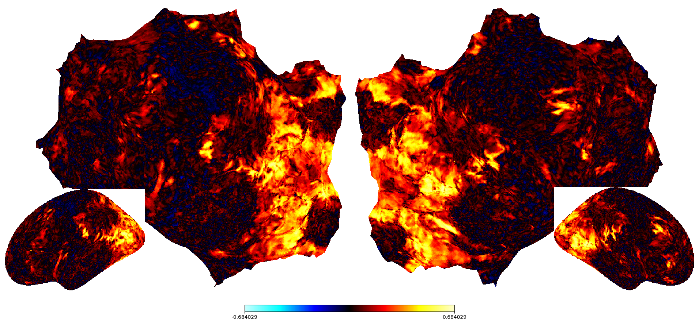

# cvnpy

`cvnpy` is a Python port of key CVN visualization workflows from Kendrick Kay's MATLAB `cvncode`, focused on production-quality cortical flatmaps, inflated surfaces, statistical overlays, ROI/text overlays, and layered SVG export.

## Core Workflows

- Render full flatmaps using Kendrick-style fsaverage cuts.
- Render inflated FreeSurfer surfaces.
- Overlay per-vertex statistical maps with thresholding and symmetric color limits.
- Export layered SVGs with independent objects for curvature, stats, ROIs, labels, colorbars, and insets.
- Batch-render model-layer results for publication figures.

## Example



## Install

```bash
pip install cvnpy
```

For development:

```bash
python3 -m venv .venv
.venv/bin/python -m pip install -e ".[dev,docs]"
```

## Data

`cvnpy` does not ship cortical surface data. Provide a FreeSurfer-style subject directory with a `surf/` folder, such as an NSD fsaverage derivative.

```bash
examples/flatmap_demo.py \
  --subject-dir /path/to/nsd_fsaverage \
  --hemi both \
  --surftype full.flat.patch.3d \
  --out out/flatmap.png
```
